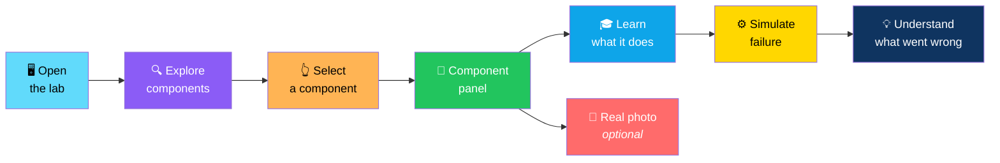
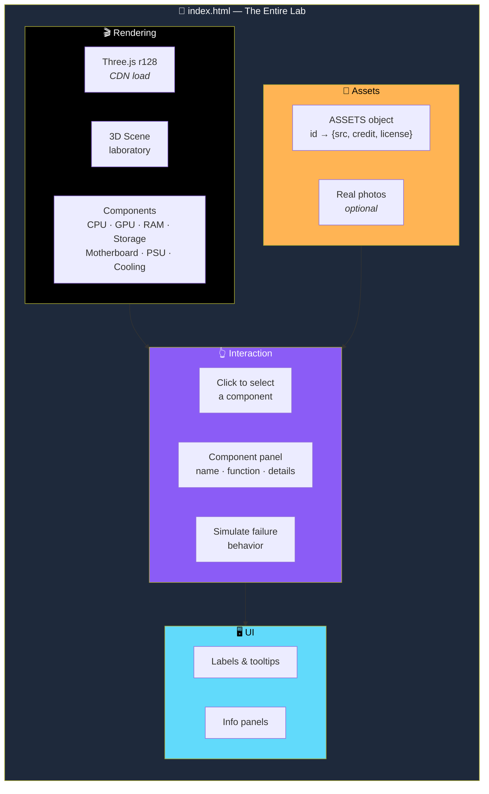

# 🖥️ PCVERSE — The Computer Laboratory

<div align="center">


**An interactive 3D computer laboratory.**

*Explore PC components · Learn how the inside of a computer works*

[🚀 Run It](#-run-it) • [📸 Real Photos](#-real-photos) • [⚠️ Simulation Notes](#-simulation-notes) • [🏗️ Architecture](#️-architecture)

</div>

---

## 📖 Overview

**PCVERSE** is an **interactive 3D computer laboratory** for the browser.

### Core Idea

> **A hands-on way to understand what's inside the box.**
>
> Explore real PC components in 3D, learn what each one does, and see failure behavior in a safe, simulated way.

### The Learning Loop



---

## 🚀 Run It

### Just Open It

**Open `index.html`** in a browser.

> ⚠️ **Internet needed once to load three.js r128 from cdnjs.**
>
> **After that, the lab works offline.**

---

## 📸 Real Photos

> **The lab already works out of the box — but you can make each component panel richer by adding real photos.**

### How It Works

**Add licensed or self-shot images to the `ASSETS` object in `index.html`:**

```js
const ASSETS = {
  cpu: {
    src: 'assets/cpu.jpg',
    credit: 'Photo by ___',
    license: 'CC BY 4.0'
  },
  gpu: {
    src: 'assets/gpu.jpg',
    credit: 'Self-shot',
    license: 'Own work'
  },
  // ...more components
};
```

**They appear in each component panel.**

### ✅ Assets Guidelines

<div align="center">

| Rule | Why |
|:----:|-----|
| **Use licensed or self-shot images** | **Respects photographers' rights** |
| **Record credit** | **Attribution matters** |
| **Record license** | **Clarity for anyone sharing the lab** |

</div>

---

## ⚠️ Simulation Notes

> **This is a learning tool — not a diagnostic or repair utility.**

<div align="center">

| Note | Details |
|:----:|---------|
| **Simulated failures** | **All failure behavior is SIMULATED** — **no real hardware is affected** |
| **Layouts vary** | **Layouts vary by manufacturer and model** — **your real hardware may look different** |
| **Educational purpose** | **The lab teaches concepts** — **it does not diagnose real problems** |

</div>

> ⚠️ **Do not use PCVERSE to troubleshoot real hardware.** Consult your manufacturer's documentation for actual failures.

---

## 🏗️ Architecture

### System Overview



### Design Principles

<div align="center">

| Principle | Implementation |
|:---------:|---------------|
| **📄 One file, zero build** | **The whole lab is `index.html`** — **open it and it works** |
| **🌐 CDN loading** | **Three.js r128 loads from cdnjs on first run** — **after that, the lab is offline** |
| **👆 Click to learn** | **Every component is selectable** — **selection opens a panel explaining what it does** |
| **📸 Pluggable photos** | **The `ASSETS` object lets you add licensed or self-shot images without touching any other code** |
| **⚠️ Honest simulation** | **All failure behavior is simulated** — **layouts vary by manufacturer** — **this is educational, not diagnostic** |
| **🎓 Educational focus** | **Learning is the point** — **every panel is designed to teach something** |

</div>

---

## 🗺️ Roadmap

### ✅ Current

- [x] Single-file interactive 3D computer laboratory
- [x] Three.js r128 rendered scene
- [x] Click-to-select component interaction
- [x] Component panels explaining each part
- [x] Simulated failure behavior for each component
- [x] Pluggable `ASSETS` object for real photos
- [x] Photo credit and license tracking in `ASSETS`
- [x] Works offline after first load
- [x] Honest disclosure that failures are simulated
- [x] Honest disclosure that layouts vary by manufacturer and model

### 🔜 Future Ideas

- [x] **More components** — beyond CPU, GPU, RAM, storage, motherboard, PSU, and cooling
- [ ] **Step-by-step assembly mode** — build a PC from parts
- [ ] **Troubleshooting scenarios** — guided diagnosis practice
- [ ] **Quiz mode** — test your knowledge of components
- [ ] **Multiple lab presets** — desktop, laptop, server
- [ ] **Additional photos** — built-in licensed defaults
- [ ] **Localization** — bilingual labels and panels
- [ ] **Accessibility options** — keyboard navigation, screen reader labels
- [ ] **PWA support** — install and run the lab offline
- [ ] **Export notes** — save what you've learned as a summary

---

## 🤝 Contributing

Contributions are welcome. Please:

1. Fork the repository
2. **Keep it single-file** — no external build step, no bundler
3. **Keep it educational** — every addition should help someone learn
4. **Keep failure behavior clearly simulated** — never claim to diagnose real hardware
5. **Only use licensed or self-shot photos** in `ASSETS` — with credit and license
6. **Disclose layout variation** — manufacturer and model differences are real
7. **Preserve offline-first behavior** after the first load
8. **Test in a WebGL-capable browser** before submitting
9. Submit a Pull Request

### Guidelines

- **Never ship an unlicensed image** — attribution and license are mandatory in `ASSETS`
- **Never claim to diagnose real hardware failures**
- **Never present simulated behavior as real behavior**
- **Never add a required external dependency** beyond Three.js
- **Never break the offline experience** after first load

---

## 📜 License

MIT — see [LICENSE](LICENSE) for details.

> 📸 **Photo credits and licenses are recorded per-image in the `ASSETS` object** — **please respect them when sharing the lab.**

---

## 🙏 Acknowledgments

- **Three.js** — for making an interactive 3D lab possible in a single file
- **Every tech educator who's ever cracked open a case with students** — this one's for you

---

<div align="center">

### 🖥️ EXPLORE. LEARN. UNDERSTAND.

**An interactive 3D computer laboratory.**

**Click a component. Learn what it does. See what happens when it fails.**

<br>

> ⚠️ **All failures are simulated. Layouts vary by manufacturer and model.**

<br>

⭐ If PCVERSE helped you understand your PC, consider giving it a star.

<br>

[⬆ Back to Top](#️-pcverse--the-computer-laboratory)

</div>
